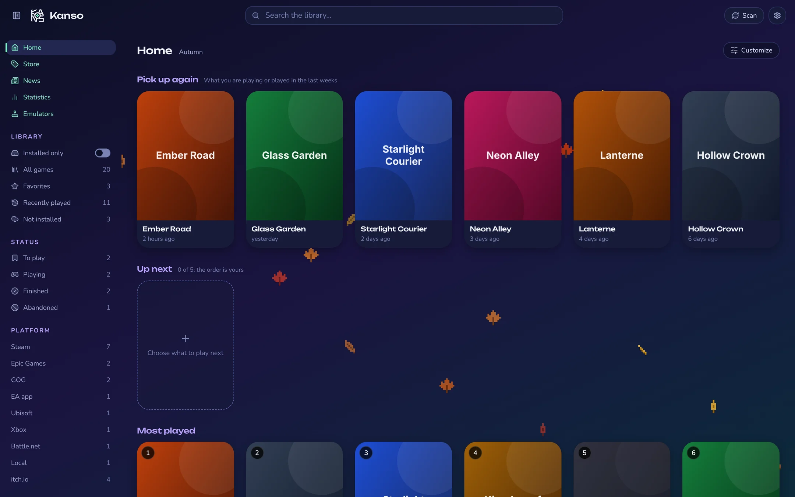
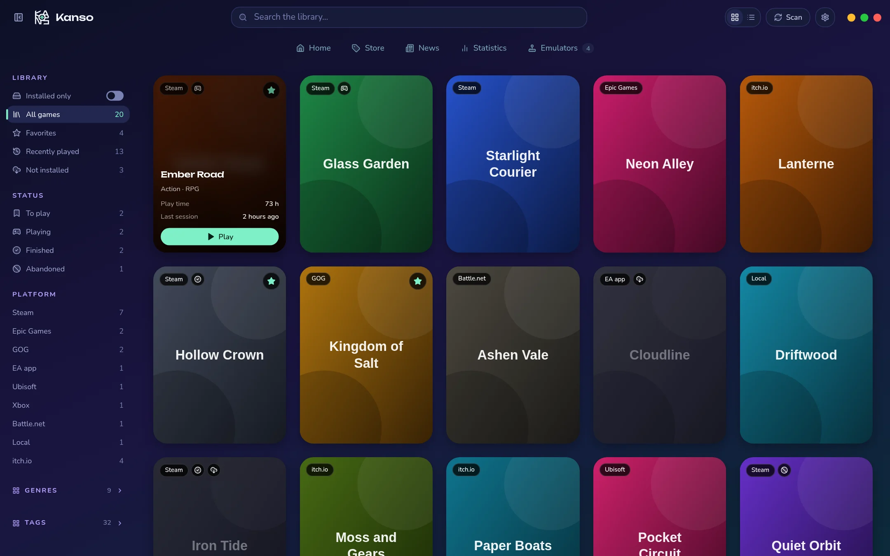
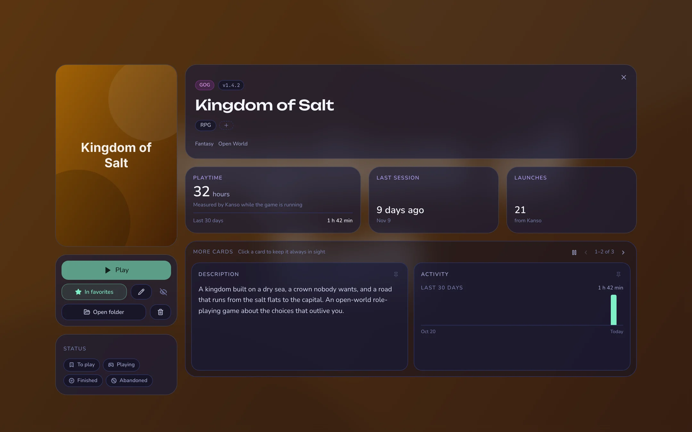
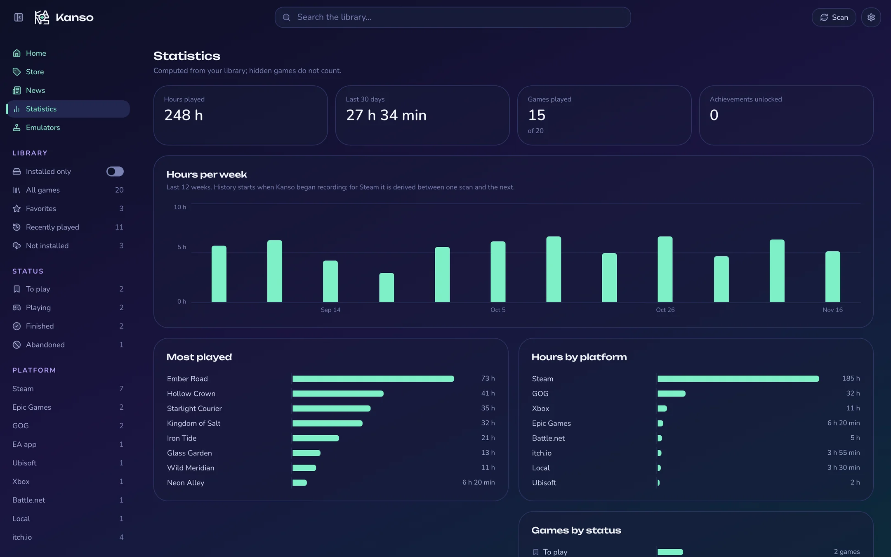
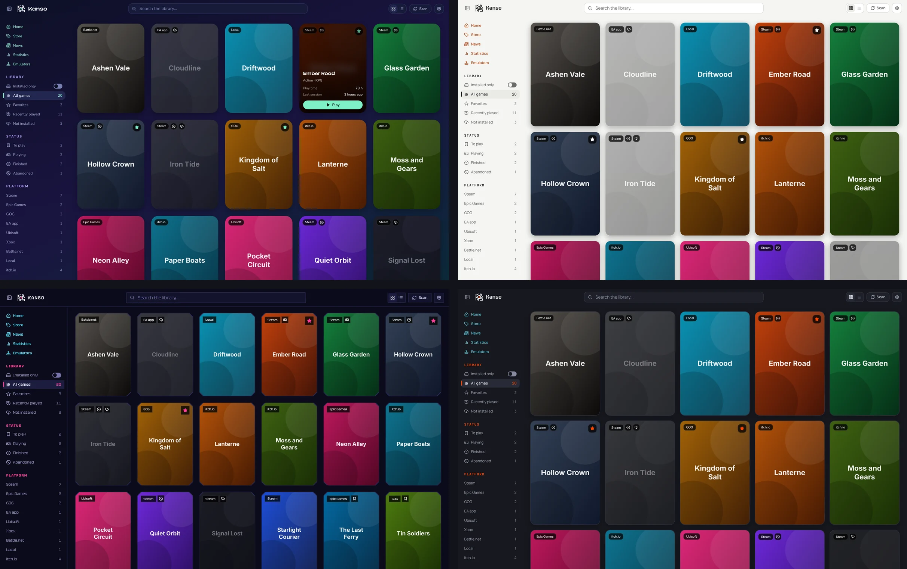
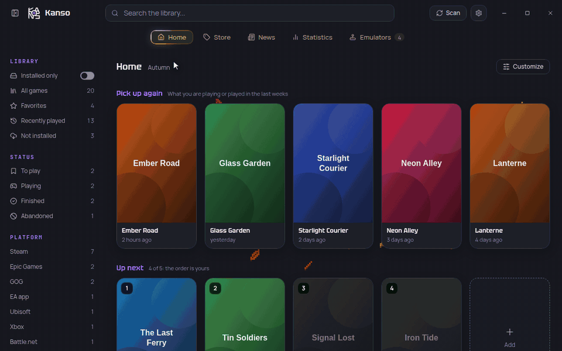
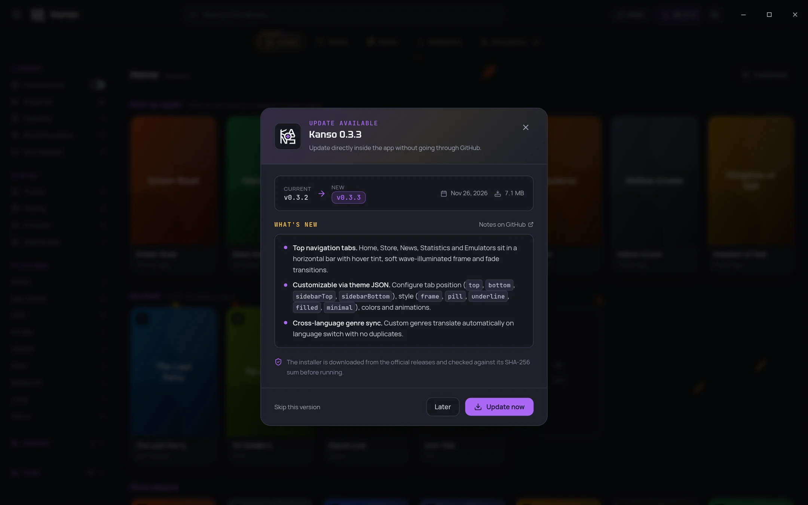
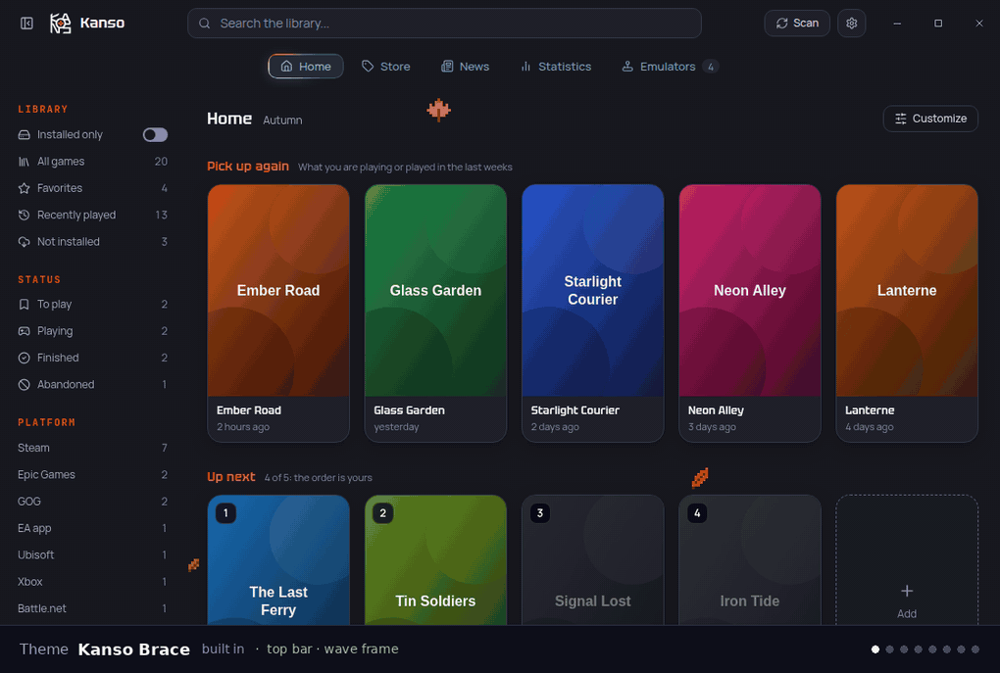

<p align="center">
  
</p>

<h1 align="center">Kanso</h1>

<p align="center">
  Un launcher di giochi per Windows, pulito e leggero.<br>
  Tutti gli store in una sola libreria, ridisegnata dai temi ed estesa dai plugin, senza nessun account nostro da creare.
</p>

<p align="center"><a href="README.md">English</a></p>



## Che cosa fa

- **Una sola libreria.** Kanso trova sul PC i giochi di Steam, Epic Games, GOG, Ubisoft
  Connect, EA app, Battle.net e dell'app Xbox, più le cartelle di giochi sfusi che gli
  indichi. Elenca anche quelli che possiedi ma non hai installato, e quando vuoi installarne
  uno lo passa al client del suo store.
- **Nessuna registrazione.** Non esiste un account Kanso, né un server, né telemetria. Quasi
  tutto quello che Kanso sa lo legge dai file che i client degli store tengono già sul PC.
  Accedere a uno store è facoltativo e avviene sulla pagina dello store stesso.
- **Da ridisegnare.** Un tema è un solo file `.json` che cambia colori, font, forme e
  animazioni, e ridisegna il pannello laterale, le schede di navigazione (posizione, stile,
  colori e animazioni) e le pagine Home, Store e News. Non contiene codice: importare il tema
  di uno sconosciuto è sicuro.
- **Da estendere.** I plugin aggiungono sezioni alla scheda di un gioco, etichette alle
  copertine, comandi, parti della Home e intere librerie di giochi di altri servizi. Girano
  in una sandbox e raggiungono solo i siti che dichiarano.
- **Leggero.** Una finestra nativa, un installer piccolo, e una libreria di migliaia di giochi
  che scorre come una di venti.

| | |
|---|---|
|  |  |
|  |  |



Le schermate sono in inglese; l'interfaccia è anche in italiano, spagnolo e russo.

## Funzioni

- **Navigazione**: barra superiore per **Home**, **Store**, **News**, **Statistiche** ed
  **Emulatori**, con schede opache in tinta col tema che si illuminano al passaggio del mouse,
  riquadro ad onda soft sulla scheda selezionata e transizioni fade — ogni dettaglio
  personalizzabile nei file di tema.
- **Libreria**: griglia di copertine o elenco compatto, ricerca immediata e filtri che si
  combinano: preferiti (inclusi i giochi emulati preferiti), giocati di recente, non
  installati, piattaforma, stato, generi e tag di Steam. Generi e tag si aprono anche come
  pareti di copertine, contate su tutte le piattaforme o su quella che scegli. *Solo
  installati* lascia fuori tutto il resto in un colpo. I giochi che ti arrivano dalla
  condivisione familiare di Steam sono contrassegnati, installati o no.
- **Copertine e dettagli** da [SteamGridDB](https://www.steamgriddb.com) (con la tua chiave
  gratuita) e dallo store di Steam, nella tua lingua. I giochi di Steam hanno la copertina
  anche senza chiave.
- **Ore di gioco e stato**: i contatori di Steam sono letti dai suoi file locali; i giochi
  degli altri store li cronometra Kanso mentre sono in esecuzione. Segna un gioco come da
  giocare, in corso, finito o abbandonato, e guarda i totali nella pagina delle statistiche.
  Gli obiettivi di Steam sono letti dalla cache locale del client.
- **Home**: i giochi da riprendere, una coda dei prossimi, i più giocati, suggerimenti per
  genere e le offerte migliori, su uno sfondo in pixel art che segue la stagione, le festività
  e, se lo accendi, il meteo.
- **Store**: sconti e giochi gratis del momento su Steam, Epic Games, GOG e altri negozi. Un
  «mi piace» tiene da parte un'offerta e ti avvisa quando sta per finire.
- **News** su giochi per PC e hardware, dai feed pubblici dei siti.
- **Emulatori**: ne riconosce una ventina (RetroArch, Dolphin, PCSX2, DuckStation, RPCS3,
  PPSSPP e altri), ciascuno con i giochi delle cartelle elencate nelle sue impostazioni. Kanso
  avvia l'emulatore con il gioco e non scarica nulla. Vedi [docs/EMULATORS.md](docs/EMULATORS.md).
- **DLSS**: la scheda di un gioco mostra le versioni di DLSS che contiene. Su richiesta Kanso
  le aggiorna, conservando gli originali e accettando solo librerie firmate da NVIDIA.
  Vedi [docs/DLSS.md](docs/DLSS.md).
- **Aggiornamenti in app**: controlla automaticamente le release su GitHub all'avvio (o su
  richiesta in *Impostazioni → Generale*) e propone le nuove versioni in una finestra
  coordinata con il tema attivo, con download diretto e verifica SHA-256.
- **Accessibilità**: dimensione del testo, alto contrasto, meno movimento, font ad alta
  leggibilità e fuoco da tastiera più evidente, sopra qualunque tema.
- **Quattro lingue**: italiano, inglese, spagnolo e russo — inclusa la traduzione automatica
  e la rimozione dei doppioni per generi e categorie personalizzate al cambio lingua.

## Scaricare

L'installer è nella [pagina delle Release](https://github.com/SpheralComa441/Kanso/releases/latest)
(`Kanso_…_x64-setup.exe`). Windows 10 o 11, 64 bit.

Kanso disegna la sua interfaccia con WebView2 di Microsoft, che Windows 11 e un Windows 10
aggiornato hanno già. Dove manca lo scarica l'installer, quindi quella prima installazione
richiede una connessione.

L'installer **non è ancora firmato con un certificato di editore**, quindi Windows SmartScreen
dice di non riconoscere l'app: scegli *Ulteriori informazioni*, poi *Esegui comunque*. Ogni
release elenca le somme SHA-256 dei suoi file, per controllare che quello che hai scaricato
sia quello costruito qui. La firma è in arrivo: vedi la
[politica di firma del codice](#politica-di-firma-del-codice).

Una volta installato, Kanso controlla automaticamente le nuove versioni su GitHub all'avvio
(disattivabile in *Impostazioni → Generale*) e propone di scaricare, verificare tramite
SHA-256 e installare gli aggiornamenti direttamente in app, con una finestra in linea con il
tema attivo.



## Temi e plugin

- **Temi**: otto sono inclusi, e *Impostazioni → Aspetto* ha un editor di colori e font con
  anteprima dal vivo. Per tutto il resto — forme delle card, layout, icone, font incorporati
  e personalizzazione completa delle schede di navigazione (posizione in alto, in basso o nel
  pannello laterale, stile, sfondo barra, colori, animazioni e transizioni) — si scrive o si
  importa un file di tema: [docs/THEMES.md](docs/THEMES.md), con esempi in
  [docs/themes/](docs/themes/).
- **Plugin**: nove ufficiali sono inclusi (quanto dura un gioco, recensioni e notizie di
  Steam, PCGamingWiki, Nexus Mods, storico dei prezzi, cosa giocare stasera, il gioco di
  oggi, la libreria di un account itch.io). Quelli che contattano un sito diverso da Steam
  sono spenti finché non li accendi. Per scriverne uno: [docs/PLUGINS.md](docs/PLUGINS.md).



Temi e plugin parlano con Kanso solo attraverso i formati descritti in quelle guide. Sono
lavoro tuo: pubblicali dove vuoi, con la licenza che scegli.

**Fatti da altri.** Qui nessuno li approva né li ospita: ognuno sta nel repository del suo
autore, elencato su GitHub sotto i topic
[`kanso-theme`](https://github.com/topics/kanso-theme) e
[`kanso-plugin`](https://github.com/topics/kanso-plugin). Aggiungi il topic al tuo e compare
nell'elenco. Domande, idee e «guardate che cosa ho fatto» vanno nelle [Discussions](https://github.com/SpheralComa441/Kanso/discussions).

## Riservatezza e sicurezza

- **Nessun server, nessuna telemetria.** Le richieste partono dal tuo PC e vanno direttamente
  agli store e ai servizi che Kanso legge, e a niente di nostro. Ogni richiesta, a chi va,
  quando e che cosa porta con sé: [PRIVACY.md](PRIVACY.md) (in inglese).
- **La tua password non passa mai da Kanso.** Accedere a uno store è facoltativo e avviene
  sempre sulla pagina dello store (nel tuo browser, o in una finestra separata che mostra la
  pagina dello store): Kanso non legge, non salva e non invia la password né i codici a due
  fattori. Sul PC resta solo la sessione rilasciata dallo store, cifrata per il tuo utente
  Windows oppure come cookie dello store in un profilo usato solo da quella finestra; è usata
  con quello store e con nient'altro, ed *Esci* la cancella. Che cosa viene conservato e dove,
  store per store, con i file da leggere per verificare ogni affermazione:
  [docs/ACCOUNTS.md](docs/ACCOUNTS.md).
- **Un tema non può contenere codice**, e **un plugin non può raggiungere i tuoi file, le tue
  impostazioni o l'interfaccia**: restituisce dati, e li disegna Kanso.

Il quadro completo, e come segnalare un problema in privato: [SECURITY.md](SECURITY.md).

## Stato

Kanso è giovane ed è in sviluppo attivo (0.3.x); è stato costruito da pochissime persone e
provato su pochissimi PC. I test automatici coprono i lettori dei file, l'updater, il validatore
dei temi e ogni plugin ufficiale, ma molto di ciò che parla con un vero client o con un vero
servizio web è stato provato solo su dati registrati o costruiti. Quello che nessuno ha ancora
visto funzionare è elencato, riga per riga, in [docs/MANUAL-TESTS.md](docs/MANUAL-TESTS.md). Se
qualcosa non funziona sul tuo PC, [apri una segnalazione](https://github.com/SpheralComa441/Kanso/issues):
è la cosa più utile che puoi fare per il progetto.

## Compilare dai sorgenti

Servono Node.js 22 e una toolchain Rust stabile, su Windows 10 o 11.

```bash
npm install
```

```bash
npx tauri build
```

`npm run dev` apre un'anteprima nel browser con una libreria di esempio, su qualunque sistema.
Com'è fatto il codice, i controlli da eseguire e come si fa una release:
[docs/DEVELOPMENT.md](docs/DEVELOPMENT.md) (in inglese). Per contribuire:
[CONTRIBUTING.md](CONTRIBUTING.md).

## Politica di firma del codice

Gli installer non sono ancora firmati. Kanso sta chiedendo la firma gratuita che la SignPath
Foundation offre ai progetti open source; questa è la politica che le release firmate
seguiranno.

Free code signing provided by [SignPath.io](https://about.signpath.io/), certificate by
[SignPath Foundation](https://signpath.org/).

- **Che cosa viene firmato**: solo il programma e gli installer costruiti dai sorgenti di
  questo repository dal [workflow Release](.github/workflows/release.yml), sulle macchine di
  GitHub. Niente di costruito sul PC di qualcuno viene firmato.
- **Chi può modificare il codice e chi lo rivede** (*Committers and reviewers*):
  [SpheralComa441](https://github.com/SpheralComa441)
- **Chi approva una firma** (*Approvers*): [SpheralComa441](https://github.com/SpheralComa441)
- Kanso ha un solo manutentore, che ricopre ogni ruolo. Le modifiche di chiunque altro
  arrivano come pull request e sono lette dal manutentore prima di essere unite, e ogni
  release è approvata a mano.
- **Privacy**: [PRIVACY.md](PRIVACY.md). Kanso non ha un server suo a cui mandare qualcosa;
  che cosa chiede agli altri servizi, e quando, è elencato lì.

## Licenza

Kanso è software libero, rilasciato sotto la
[GNU General Public License, versione 3 o successive](LICENSE). I font inclusi sono sotto la
SIL Open Font License ([public/font-licenses.txt](public/font-licenses.txt)).

Kanso non è affiliato a Valve, Epic Games, GOG, Ubisoft, Electronic Arts, Blizzard, Microsoft,
NVIDIA, itch.io né ad alcuna altra società di cui legge lo store o il servizio. Nomi e marchi
appartengono ai rispettivi proprietari. Le schermate mostrano una libreria inventata.
