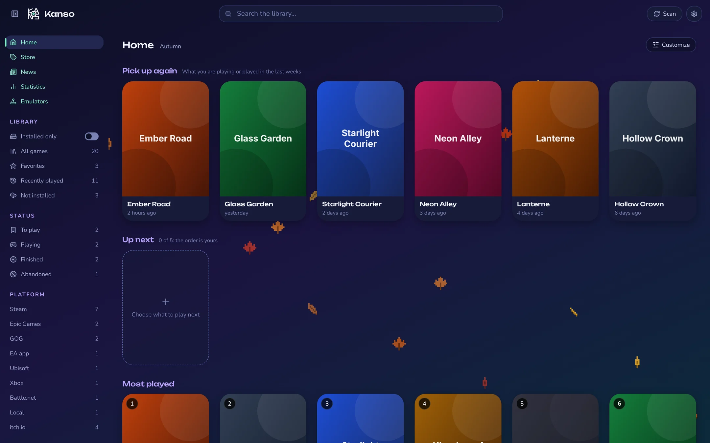
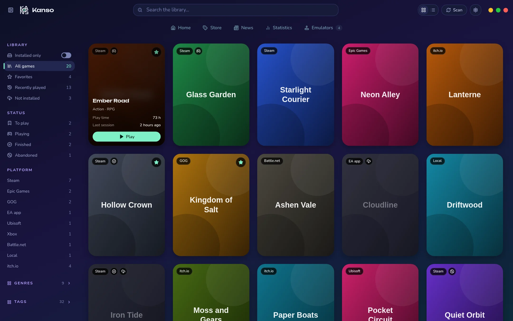
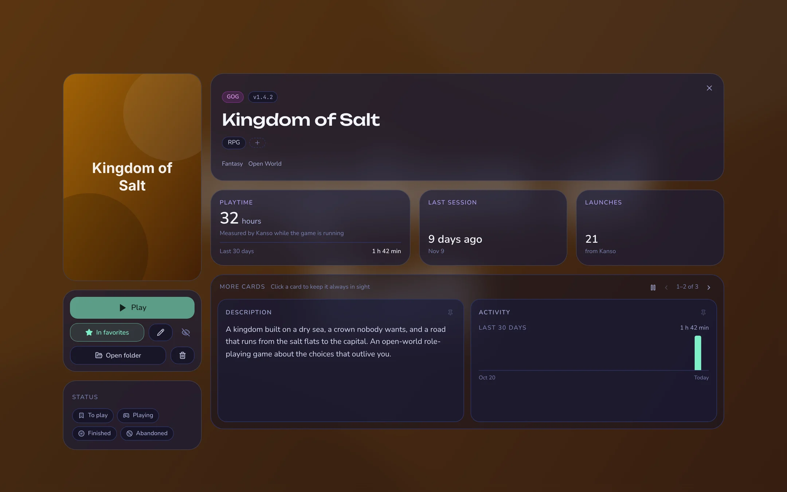
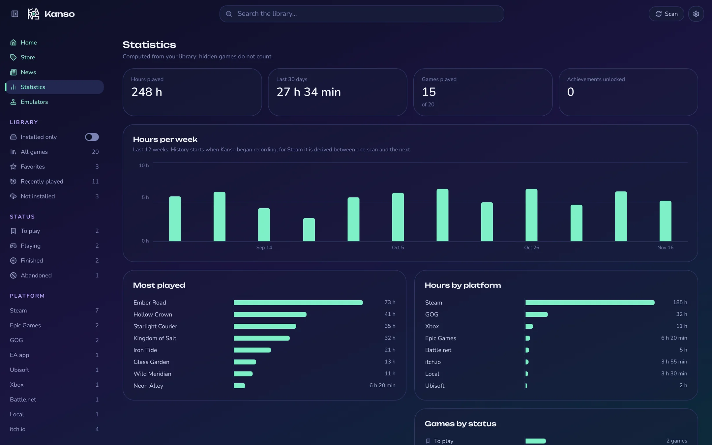
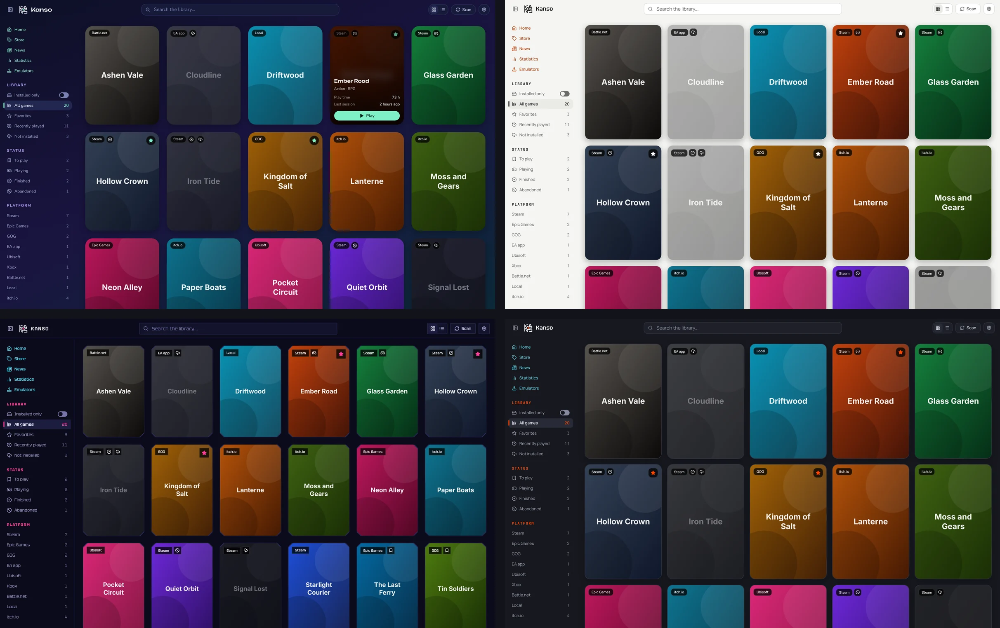
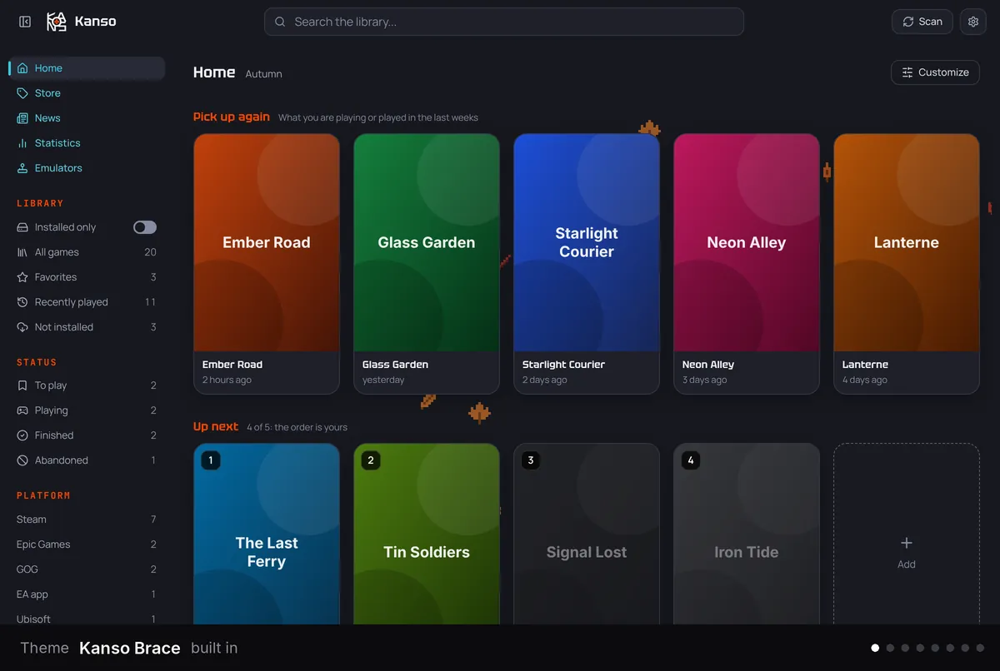

<p align="center">
  
</p>

<h1 align="center">Kanso</h1>

<p align="center">
  A clean, light game launcher for Windows.<br>
  Every store in one library, restyled by themes and extended by plugins, with no account of ours to create.
</p>

<p align="center">
  <a href="https://github.com/SpheralComa441/Kanso/releases/latest"></a>
  <a href="https://github.com/SpheralComa441/Kanso/actions/workflows/build-windows.yml"></a>
  <a href="LICENSE"></a>
</p>

<p align="center"><a href="README.it.md">Italiano</a></p>



## What it does

- **One library.** Kanso finds the games of Steam, Epic Games, GOG, Ubisoft Connect, EA app,
  Battle.net and the Xbox app on your PC, plus the folders of loose games you point it at. It
  also lists what you own but have not installed, and hands a game to its store's client when
  you want to install it.
- **Nothing to sign up for.** There is no Kanso account, no server and no telemetry. Most of
  what Kanso knows it reads from the files the store clients already keep on your PC. Signing
  in to a store is optional, and happens on the store's own page.
- **Yours to restyle.** A theme is a single `.json` file that changes colours, fonts, shapes
  and motion, and rearranges the side panel and the Home, Store and News pages. It carries no
  code, so a theme from a stranger is safe to import.
- **Yours to extend.** Plugins add sections to a game's sheet, labels to the covers, commands,
  parts of the Home page, and whole libraries of games from other services. They run in a
  sandbox and reach only the sites they declare.
- **Light.** A native window, a small installer, and a library of thousands of games that
  scrolls as easily as one of twenty.

| | |
|---|---|
|  |  |
|  |  |

## Features

- **Library**: a grid of covers or a compact list, instant search, and filters that combine:
  favourites, recently played, not installed, platform, status, genres and Steam tags.
  Genres and tags also open as walls of covers, counted on every platform or on the one you
  pick. *Installed only* leaves everything else out at once. Games that reach you through Steam
  family sharing are marked, installed or not.
- **Covers and details** from [SteamGridDB](https://www.steamgriddb.com) (with your own free
  key) and the Steam store, in your language. Steam games get covers without a key.
- **Play time and status**: Steam's counters are read from its local files; games from other
  stores are timed by Kanso while they run. Mark a game as to play, playing, finished or
  abandoned, and see the totals on the statistics page. Steam achievements are read from the
  client's local cache.
- **Home**: what to pick up again, a queue of what to play next, your most played games,
  suggestions by genre and the best discounts, over a pixel-art background that follows the
  season, the holidays and, if you turn it on, the weather.
- **Store**: current discounts and free games on Steam, Epic Games, GOG and other shops. Like
  a deal to keep it aside, and be told when it is about to end.
- **News** about PC games and hardware, from the sites' own public feeds.
- **Emulators**: about twenty are recognised (RetroArch, Dolphin, PCSX2, DuckStation, RPCS3,
  PPSSPP and others), each with the games in the folders its own settings list. Kanso starts
  the emulator with the game and downloads nothing. See [docs/EMULATORS.md](docs/EMULATORS.md).
- **DLSS**: a game's sheet shows the versions of DLSS it carries. On request Kanso updates
  them, keeping the originals and accepting only libraries signed by NVIDIA.
  See [docs/DLSS.md](docs/DLSS.md).
- **Accessibility**: text size, high contrast, reduced motion, high-legibility fonts and a
  stronger keyboard focus, on top of any theme.
- **Four languages**: English, Italian, Spanish and Russian.

## Download

Get the installer from the [Releases page](https://github.com/SpheralComa441/Kanso/releases/latest)
(`Kanso_…_x64-setup.exe`). Windows 10 or 11, 64-bit.

Kanso draws its interface with Microsoft's WebView2, which Windows 11 and an up-to-date
Windows 10 already have. Where it is missing the installer downloads it, so that first
install needs a connection.

The installer is **not signed with a publisher certificate yet**, so Windows SmartScreen says
it does not recognise the app: choose *More info*, then *Run anyway*. Each release lists the
SHA-256 sums of its files, to check that what you downloaded is what was built here.
Signing is on its way: see the [code signing policy](#code-signing-policy).

Once installed, Kanso checks GitHub Releases automatically on startup (configurable in
*Settings → General*) and offers to download, SHA-256 verify and install new versions directly
in the app.

## Themes and plugins

- **Themes**: eight are built in, and *Settings → Appearance* has an editor for colours and
  fonts with a live preview. For everything else, write or import a theme file:
  [docs/THEMES.md](docs/THEMES.md), with examples in [docs/themes/](docs/themes/).
- **Plugins**: nine official ones ship with Kanso (how long a game takes, Steam reviews and
  news, PCGamingWiki, Nexus Mods, price history, what to play tonight, today's pick, the
  library of an itch.io account). Those that contact a site other than Steam are off until
  you switch them on. To write your own: [docs/PLUGINS.md](docs/PLUGINS.md).



Themes and plugins talk to Kanso only through the formats described in those guides. They are
your own work: publish them wherever you like, under the licence you choose.

**Made by others.** Nobody approves or hosts them here: each lives in its author's own
repository, listed on GitHub under the topics
[`kanso-theme`](https://github.com/topics/kanso-theme) and
[`kanso-plugin`](https://github.com/topics/kanso-plugin). Add the topic to yours and it is
listed too. Questions, ideas and show-and-tell go in the [Discussions](https://github.com/SpheralComa441/Kanso/discussions).

## Privacy and security

- **No server, no telemetry.** Requests go from your PC straight to the stores and services
  Kanso reads, and to nothing of ours. Every request, to whom, when and what it carries:
  [PRIVACY.md](PRIVACY.md).
- **Your password never passes through Kanso.** Signing in to a store is optional and always
  happens on the store's own page (your browser, or a separate window showing the store's
  page): Kanso does not read, save or send your password or your two-factor codes. Only the
  session the store issues stays on your PC, encrypted for your Windows user or as the
  store's own cookies in a profile used by that window alone; it is used with that store and
  nothing else, and *Sign out* deletes it. What is kept and where, store by store, with the
  files to read to check each statement: [docs/ACCOUNTS.md](docs/ACCOUNTS.md).
- **A theme cannot carry code**, and **a plugin cannot reach your files, your settings or the
  interface**: it returns data, and Kanso draws it.

The whole picture, and how to report a problem privately: [SECURITY.md](SECURITY.md).

## Status

Kanso is young. Version 0.1 is the first public release; it has been built by very few people
and tried on very few PCs. The automated tests cover the parsers, the theme validator and
every official plugin, but much of what talks to a real store client or a real web service
has been tried only against recorded or constructed data. What nobody has seen working yet is
listed, line by line, in [docs/MANUAL-TESTS.md](docs/MANUAL-TESTS.md). If something does not
work on your PC, [open an issue](https://github.com/SpheralComa441/Kanso/issues): it is the
most useful thing you can do for the project.

## Building from source

You need Node.js 22 and a stable Rust toolchain, on Windows 10 or 11.

```bash
npm install
```

```bash
npx tauri build
```

`npm run dev` opens a browser preview with a sample library on any system. The layout of the
code, the checks to run and how a release is made: [docs/DEVELOPMENT.md](docs/DEVELOPMENT.md).
To contribute: [CONTRIBUTING.md](CONTRIBUTING.md).

## Code signing policy

The installers are not signed yet. Kanso is applying for the free code signing that the
SignPath Foundation offers to open source projects; this is the policy its signed releases
will keep.

Free code signing provided by [SignPath.io](https://about.signpath.io/), certificate by
[SignPath Foundation](https://signpath.org/).

- **What is signed**: only the program and the installers built from the source in this
  repository by the [Release workflow](.github/workflows/release.yml), on GitHub's own
  runners. Nothing built on somebody's PC is signed.
- **Committers and reviewers**: [SpheralComa441](https://github.com/SpheralComa441)
- **Approvers**: [SpheralComa441](https://github.com/SpheralComa441)
- Kanso has one maintainer, who holds every role. Changes from anyone else arrive as pull
  requests and are read by the maintainer before they are merged, and each release is
  approved by hand.
- **Privacy policy**: [PRIVACY.md](PRIVACY.md). Kanso has no server of its own to send
  anything to; what it asks other services for, and when, is listed there.

## Licence

Kanso is free software, released under the
[GNU General Public License, version 3 or later](LICENSE). The fonts bundled with it are under
the SIL Open Font License ([public/font-licenses.txt](public/font-licenses.txt)).

Kanso is not affiliated with Valve, Epic Games, GOG, Ubisoft, Electronic Arts, Blizzard,
Microsoft, NVIDIA, itch.io or any other company whose store or service it reads. Their names
and marks belong to their owners. The screenshots show an invented library.
